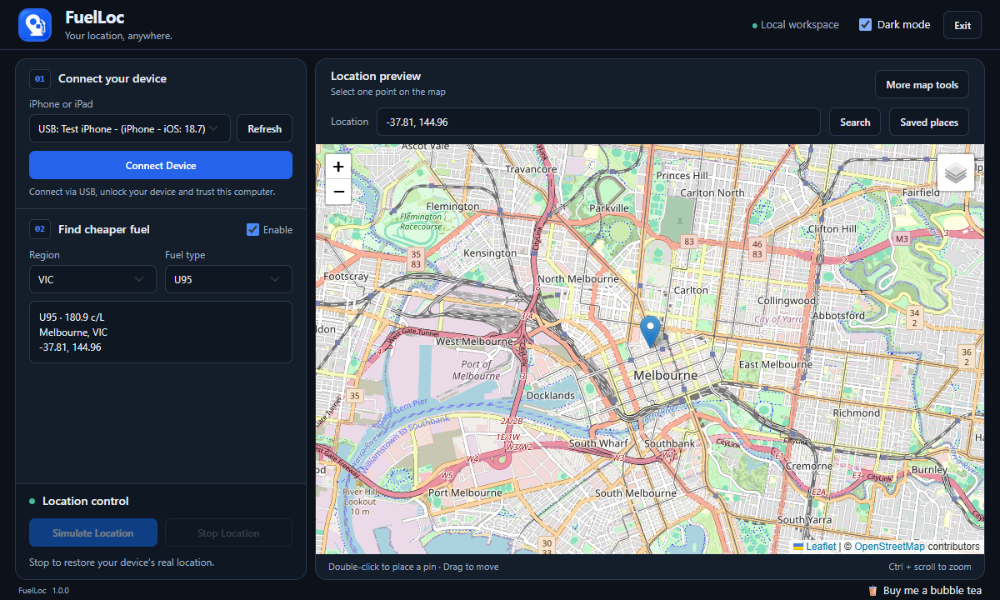

# FuelLoc

A portable Windows app for testing an iPhone's location and browsing reported Australian fuel prices, with device controls and a map in one workspace.

[Download releases](https://github.com/sunheat/FuelLoc/releases) · [Build from source](docs/BUILDING.md) · [Support on Ko-fi](https://ko-fi.com/sunheat)

## Why FuelLoc?

- **No administrator prompt for everyday use.** FuelLoc replaces the original administrator-only Windows tunnel with an in-process userspace tunnel. It does not install drivers or create a virtual network adapter.
- **The original project's telemetry and extra reporting are removed.** FuelLoc no longer sends connected-device identifiers, model, iOS version, connection type, or country to the original telemetry endpoint. The dormant visit-reporting code, remote broadcasts, remote version checks, and IP-geolocation lookup were also removed.
- **Your workspace stays local.** Device controls run on loopback; preferences and saved places stay on your PC. Maps, search, routing, and fuel prices still use the external services described below.

FuelLoc is a Windows-focused fork of GeoPort by davesc63, licensed under [GPLv3](LICENSE). Version 1.0.0 is the first FuelLoc release; it does not claim compatibility with every device supported by the original project.

Example workspace from automated acceptance checks; the device and fuel values shown are simulated.

## What it does

- Connect to your own iPhone over USB, preview a point, simulate its location, and stop simulation.
- Search by address or `latitude, longitude`, double-click to place a pin, or drag it to adjust.
- Browse the feed's reported fuel prices with region and fuel-type filters. Current region choices are All Australia, ACT, NSW, QLD, VIC, and WA; coverage depends on the feed.
- Remember theme and fuel preferences, and keep up to 30 saved places and recent simulated locations. Named places are protected from automatic replacement.
- Use a dark or light desktop workspace, with additional map tools available under **More map tools**.

## Requirements and compatibility

- **Windows x64**, with Microsoft Edge or Google Chrome installed. The release is built and tested on Windows 11 x64; other Windows versions have not been verified.
- **Apple Mobile Device Support**, included with iTunes, with its device service running. Missing drivers or service? Start with the [Apple device setup guide](docs/APPLE_DEVICE_SETUP.md), which links to Apple's current downloads and troubleshooting articles.
- Your own iPhone, a data-capable USB cable, and a trusted pairing with this computer. Unlock the phone and accept **Trust This Computer** when prompted.
- **Developer Mode** enabled on the phone under **Settings → Privacy & Security → Developer Mode**. Follow the phone's restart and confirmation prompts.
- Internet access for map resources, address search, fuel prices, and any required developer-image download.

The current device path targets iOS 17 and later. A real iPhone on iOS 18.7.7 has connected and disconnected, and a short set/clear command check succeeded through the portable EXE. The phone's displayed location was not independently verified. Older iOS versions, iPads, Wi-Fi connections, Windows ARM64, macOS, and Linux are not verified release targets.

FuelLoc deliberately leaves driver installation and system-service management to Apple's installer and Windows. This keeps driver setup separate from everyday location testing and lets FuelLoc run as a standard user without requesting administrator elevation. Installing or repairing Apple's support software may still require administrator permission. See the [short setup guide](docs/APPLE_DEVICE_SETUP.md) and [security review](SECURITY_AUDIT.md).

## Download and first launch

1. Open [Releases](https://github.com/sunheat/FuelLoc/releases) and choose the latest FuelLoc release. Download **`FuelLoc-1.0.0-windows-x64.zip`** for version 1.0.0. GitHub's **Source code** downloads are for developers and do not contain an EXE.
2. Extract the ZIP completely to a writable folder. Open the extracted `FuelLoc` folder and double-click **`FuelLoc.exe`**. Keep the `_internal` folder beside the EXE; the EXE cannot run alone or directly inside the ZIP.
3. The setup window checks the local app, browser, Apple support, and phone connection. Choose **Enter app** once the local app is ready. Failed device checks do not prevent browsing the workspace; fix them before connecting a phone. Use **Recheck** after changing prerequisites.

The EXE is unsigned, so Windows may show an unknown-publisher or reputation warning. Download only from this repository's release page; a SHA-256 checksum file is supplied with the release. You do not need to install Python to use the portable app.

### Set and restore a location

1. Connect and unlock your iPhone. Select it in FuelLoc, using **Refresh** if needed, then choose **Connect Device**.
2. Search for an address or a coordinate pair, or double-click the map and drag the pin. Searching and selecting saved places only change the preview.
3. Choose **Simulate Location** to send the point to the connected phone. The result dialog reports whether the command succeeded; applications on the phone may update at different times.
4. Choose **Stop Location** to clear simulation and restore the device's normal location source. Then **Disconnect** and use FuelLoc's **Exit** button to close the local controller.

Stop simulation before unplugging the phone. If a device operation fails, read the dialog's recovery guidance and expandable technical details. Reconnect and retry **Stop Location** if necessary. Closing the browser window alone leaves the local controller running; use **Exit** for a clean shutdown.

Hold **Ctrl** while scrolling to zoom the map, or use its **+ / −** controls. Ordinary scrolling does not zoom. **Saved places**, beside Search, lets you save, name, preview, and delete points. See [local data and retention](docs/LOCAL_STATE.md) for details.

## Fuel prices and network use

Fuel-price data comes from `projectzerothree.info`. Prices are reported feed values, with coverage and reporting delays controlled by that service; confirm prices with the station. FuelLoc reuses a successful feed download for up to five minutes. After expiry, the next fuel request refreshes it. Reloading the workspace, changing filters, or toggling fuel mode makes a request; an unchanged screen does not poll automatically. See [feed freshness](docs/FUEL_FRESHNESS.md).

Map tiles, address search, routing, and pinned interface libraries use third-party services. Those services receive your IP address and relevant requests, including searched addresses or route coordinates. Ko-fi opens separately only when you follow a support link; no payment widget is embedded in FuelLoc. The original project's device telemetry and remote broadcast/version requests have been removed.

Preferences and saved places are stored locally in `%LOCALAPPDATA%\FuelLoc\state.sqlite3`; the app's browser profile is under `%LOCALAPPDATA%\FuelLoc\BrowserProfile`. Back up the database while FuelLoc is closed. Replacing the portable folder preserves this data; removing the folder does not erase it.

## Troubleshooting

| Problem | What to check |
| --- | --- |
| EXE fails after moving or extracting it | Extract the whole ZIP again. Keep `FuelLoc.exe` and `_internal` together. The EXE under a developer's `build/` folder is only an intermediate artifact. |
| Setup reports missing Apple support | Follow the [Apple device setup guide](docs/APPLE_DEVICE_SETUP.md) to install or repair Apple's support software and check its service, then select **Recheck**. FuelLoc does not install drivers automatically. |
| Phone does not appear | Use a data-capable USB cable, unlock the phone, accept the trust prompt, then choose **Refresh**. Check that Apple's software can see it. |
| Connection or simulation fails | Check Developer Mode and the phone's prompts. Read the technical details, reconnect, and retry. Device and iOS compatibility is limited to the checks described above. |
| Workspace does not open | Install Edge or Chrome. FuelLoc needs one of them for its app window. |
| Map, search, or prices are unavailable | Check Internet access and whether the relevant provider is reachable. Missing Internet is separate from the USB connection. |
| App remains running after closing its window | Reopen the existing app window if available and choose **Exit**. If the window is unavailable, end that FuelLoc process in Task Manager before restarting or replacing files. |

Report reproducible problems through [GitHub Issues](https://github.com/sunheat/FuelLoc/issues). Include the FuelLoc version, Windows and iOS versions, steps to reproduce, and the visible error. Remove device identifiers, private addresses, and saved-location data from anything you share publicly.

## Build and contribute

See [BUILDING.md](docs/BUILDING.md) for Python 3.12 x64 setup, the Windows build command, tests, release packaging, and the limits of other operating systems. Maintainers should follow the [release checklist](docs/RELEASE_CHECKLIST.md). [Version 1.0.0 notes](docs/releases/1.0.0.md) describe the initial release.

## Support and license

If FuelLoc is useful to you, you can [buy me a bubble tea on Ko-fi](https://ko-fi.com/sunheat). Support is optional; all features remain available without donating.

FuelLoc is derived from GeoPort by davesc63. Modifications in this fork provide the FuelLoc Windows workflow, local preferences and saved places, revised device connection, fuel-cache expiry, and interface changes. The complete GPLv3 text is in [LICENSE](LICENSE), and dependency notices are described in [THIRD_PARTY_NOTICES.md](THIRD_PARTY_NOTICES.md). Matching source and build instructions accompany each FuelLoc release. The software is provided without warranty, as described in the license.
